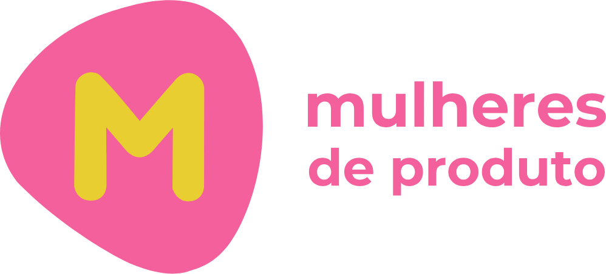
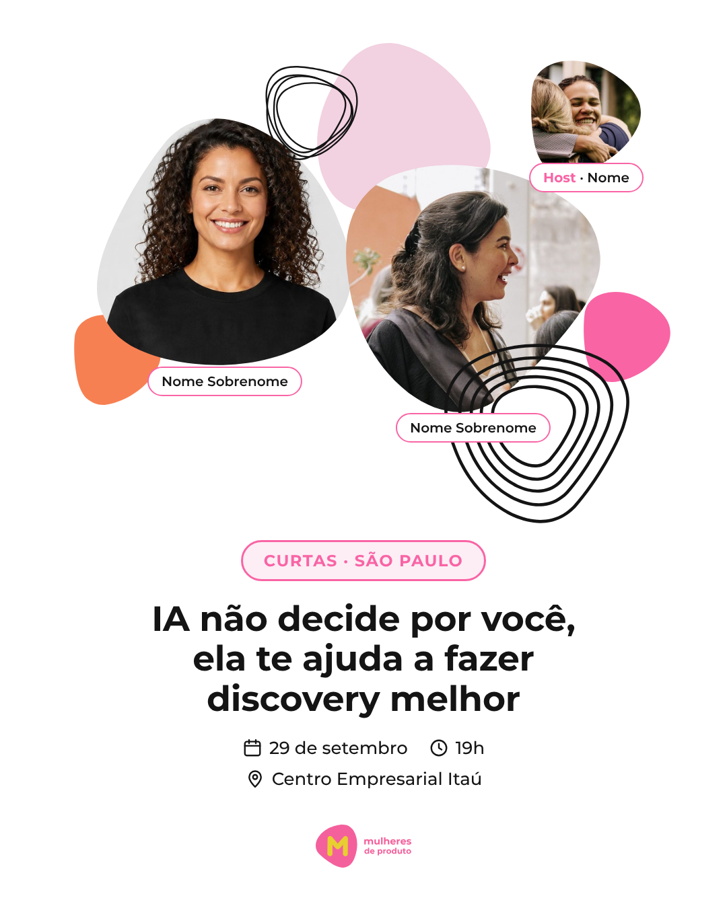
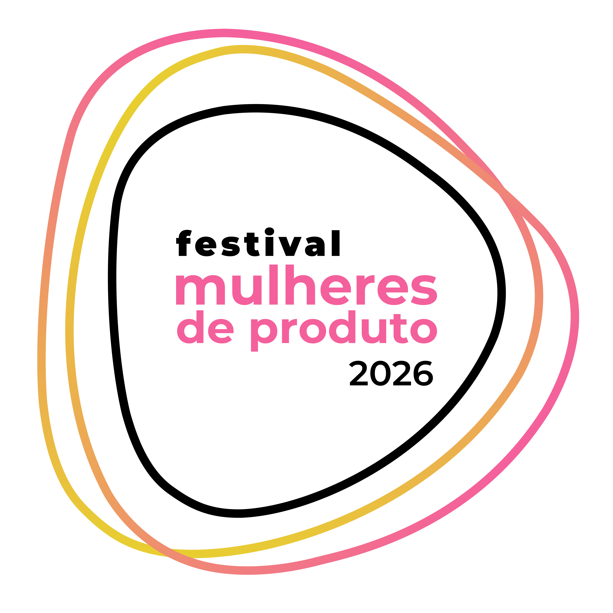

# Mulheres de Produto — Marca

Marca oficial da comunidade **Mulheres de Produto** e do **Festival Mulheres de Produto 2026**, com os assets criativos usados no evento.



## Estrutura

```
marca/                    Marca MdP (nova)
  svg/                    Vetores — use sempre que possível
  png/                    Raster 1x, @2x, @3x
  pdf/                    Composição com fotos + formas orgânicas
curtas/                   MDP Curtas: modelos de divulgação, slides e mídia kit
festival-2026/            Festival Mulheres de Produto 2026
  logo/                   Selo do festival (fundo claro e fundo escuro)
  artes-finais/           Arquivos de impressão enviados à gráfica
  vinheta/                Vinheta em vídeo (com e sem trilha)
  site/                   Layout da landing page
  fotos-e-stock/          Fotos de referência e bases de mockup
  previews/               Visão geral das artes (para compartilhar)
legacy/2018/              Marca anterior (círculo roxo) — não usar
```

## Marca Mulheres de Produto

| Versão | Arquivo | Uso |
|---|---|---|
| Principal | `marca/svg/mdp-marca-principal.svg` | Fundos claros |
| Branca | `marca/svg/mdp-marca-branca.svg` | Fundos escuros, fotos e cores da paleta |

O símbolo é o **M amarelo sobre a forma orgânica rosa**, acompanhado do nome “mulheres de produto” em rosa.

## MDP Curtas

Modelos aprovados para divulgar o meetup presencial MDP Curtas (feed, story, capa do evento e slides, com 1, 2 ou 3 palestrantes) e o mídia kit Curtas para Empresas. Veja `curtas/README.md`. Agentes de IA devem seguir `curtas/AGENTS.md`.



## Festival Mulheres de Produto 2026



| Versão | Arquivos | Uso |
|---|---|---|
| Completo | `festival-2026/logo/festival-mdp-2026-completo.*` | Fundos claros |
| Fundo escuro | `festival-2026/logo/festival-mdp-2026-fundo-escuro.*` | Fundos escuros / preto |

Selo formado por três anéis orgânicos (rosa, gradiente amarelo→laranja e preto) envolvendo “festival / mulheres de produto / 2026”.

## Paleta

| Cor | HEX | Onde aparece |
|---|---|---|
| Rosa MdP | `#F4609C` | Forma do símbolo, nome, anéis |
| Amarelo | `#E8CE31` | “M” do símbolo, anéis, fundos dos totens |
| Laranja | `#F68052` | Formas orgânicas, botões, destaques |
| Rosa claro | `#F1D1E0` | Formas de fundo, cards |
| Preto | `#000000` | Textos, anéis, fundos |
| Branco | `#FFFFFF` | Fundos, marca em negativo |

## Elementos gráficos

- **Formas orgânicas** (blobs) nas cores da paleta, sobrepostas e usadas como máscara de fotos.
- **Anéis concêntricos** em traço preto ou branco, a mesma forma do selo do festival.
- **Fotos reais da comunidade** recortadas dentro das formas — ver `marca/pdf/mdp-composicao-fotos-formas.pdf`.

## Artes finais do Festival 2026

Todos em CMYK (FOGRA39), com sangria indicada no nome do arquivo.

| Peça | Pasta | Formato |
|---|---|---|
| Camisetas “Ocupe o seu espaço” | `03_camisetas` | PDF em camadas + mockups |
| Backdrop de fotos | `05_backdrop-fotos` | 300 × 200 cm |
| Totens das salas (Auditório, 3.07, 3.14, 3.15, Home Mentorias) | `06_totens-salas` | 750 × 1900 mm |
| Totem de entrada | `07_totem-entrada` | 750 × 1900 mm |
| Totem do elevador (3º andar) | `08_totem-elevador` | 750 × 1900 mm |
| Adesivo do balcão do estande | `09_balcao-estande` | 1000 × 1000 mm |
| Painel do estande | `10_painel-estande` | 1500 × 2000 mm |
| Certificado de participação | `11_certificado` | A4 paisagem (PDF, SVG e versão para Canva) |
| Carrinho de pipoca | `12_carrinho-pipoca` | 380 × 580 mm |

> As artes contêm logos de patrocinadores e apoiadores, usados com autorização para o evento. Não reutilize fora do contexto do Festival.

## Como usar

- Prefira **SVG** para web e **PDF** para impressão; use PNG só quando o vetor não for aceito.
- Respeite uma área de respiro ao redor da marca de, no mínimo, a altura do “M”.
- Não distorça, rotacione, recolora ou aplique sombras na marca.
- Não use a marca de 2018 (`legacy/`) em novas peças.
